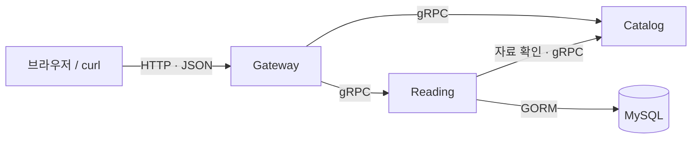

# 01. Spring의 Controller·Service·Repository를 여기서 찾기

이 장의 목표는 **어떤 기능이 어느 파일에 있는지 찾는 것**입니다. 먼저 [README의 실행 실습](../README.md)을 따라 자료 목록 응답을 한 번 확인하면 이해하기 쉽습니다.

## 1. 이 서비스는 무엇을 저장하나요?

공부할 문서를 골라 읽을거리 목록을 만드는 예제입니다.

- 자료: A Tour of Go 같은 문서의 ID, 제목, URL
- 목록: 자료들을 선택해 만든 'Go 시작하기' 목록
- 읽음 상태: 목록의 각 자료를 읽었는지 나타내는 true/false

Catalog는 자료 정보를 제공하고, Reading은 만든 목록과 읽음 상태를 DB에 저장합니다.

## 2. 이름 세 개는 애플리케이션 세 개예요

Spring Boot 애플리케이션 세 개를 각각 다른 포트로 실행한다고 생각해 보세요.

| 애플리케이션 | 하는 일 | DB 사용 |
| --- | --- | --- |
| Gateway :8080 | HTTP 요청을 받아 다른 서버를 호출하고 JSON으로 응답 | 직접 사용하지 않음 |
| Catalog :9001 | 준비된 자료 4개의 정보를 제공 | 코드에 자료를 보관 |
| Reading :9002 | 목록 생성·조회·읽음 상태 변경 | MySQL 사용 |

이 세 이름은 Controller, Service, Repository 같은 계층을 뜻하지 않습니다. 각 애플리케이션 안에 요청 처리와 업무 코드가 있습니다.



gRPC는 뒤에서 자세히 다룹니다. 지금은 '서버끼리 정해진 메서드를 호출하는 통신'이라고 이해하면 됩니다. 서버를 나눈 이유는 통신과 실패를 실습하기 위해서입니다. Go 웹 개발을 시작할 때 항상 서버를 세 개로 나눌 필요는 없습니다.

## 3. 먼저 익숙한 역할에 대응시켜 보세요

| Spring에서 찾던 것 | 이 프로젝트에서 볼 곳 | 맡은 일 |
| --- | --- | --- |
| Controller | [internal/service/reading.go](../internal/service/reading.go) | 요청을 받고 결과와 오류를 응답 형식으로 변환 |
| 업무 Service | [internal/reading/usecase.go](../internal/reading/usecase.go) | 검증 → 자료 조회 → 저장 순서 결정 |
| Repository 인터페이스 | [internal/reading/model.go](../internal/reading/model.go) | 업무 코드가 필요한 저장 동작 정의 |
| Repository 구현체 | [internal/data/reading_repository.go](../internal/data/reading_repository.go) | GORM으로 실제 MySQL 접근 |
| Entity | [internal/data/model.go](../internal/data/model.go) | DB 테이블·필드와 Go 구조체 매핑 |
| 요청·응답 DTO 원본 | [school.proto](../api/proto/school/v1/school.proto) | 서버 간 주고받는 메시지 정의 |
| @Configuration / @Bean | [internal/app/app.go](../internal/app/app.go) | 생성자와 구현체를 DI 컨테이너에 등록 |

폴더 이름 service가 Spring의 @Service 역할과 정확히 일치하지 않아 헷갈릴 수 있습니다. 이 예제의 service 패키지는 **요청 처리 어댑터라 Controller 역할**에 가깝고, 업무 로직은 reading.UseCase에 있습니다.

UseCase는 '목록을 만든다'처럼 하나의 사용 목적을 수행하는 코드라는 뜻입니다. Go가 요구하는 특별한 키워드는 아닙니다.

## 4. CreateList를 한 번 따라가세요

[Controller 역할의 파일](../internal/service/reading.go)을 열어 CreateList를 찾습니다.

```go
func (s *Reading) CreateList(ctx context.Context, req *pb.CreateListRequest) (*pb.CreateListResponse, error) {
    list, err := s.usecase.Create(ctx, reading.CreateInput{
        RequestKey: req.GetRequestKey(),
        Title: req.GetTitle(),
        ResourceIDs: req.GetResourceIds(),
    })
    if err != nil {
        return nil, s.rpcError(ctx, err)
    }
    return &pb.CreateListResponse{ReadingList: toProto(list)}, nil
}
```

위는 실제 메서드를 읽기 편하게 줄을 나눈 코드입니다. 파일 전체가 아니므로 별도 main.go에 붙여 실행하는 예시는 아닙니다.

- (s *Reading): Reading 타입의 메서드이고, s는 Java의 this에 해당하는 대상을 가리킵니다.
- req: 요청 DTO를 가리키는 포인터입니다.
- pb: import할 때 생성된 Protobuf 패키지에 붙인 별명입니다.
- ctx: 이번 요청의 취소와 제한 시간을 전달합니다.
- 반환값 두 개: 응답과 오류를 돌려줍니다.

이 메서드는 요청 DTO를 reading.CreateInput으로 바꿔 업무 코드를 호출합니다. 그다음 [UseCase.Create](../internal/reading/usecase.go)로 이동해 세 곳을 찾으세요.

1. title과 ResourceIDs 검사: 잘못된 입력을 거절합니다.
2. u.catalog.GetResources: Catalog 서버에서 자료를 확인합니다.
3. u.repo.Create: 검증된 목록을 저장합니다.

마지막으로 [Repository.Create](../internal/data/reading_repository.go)를 열면 GORM Transaction과 Create가 보입니다. 여기까지가 생성 요청의 핵심 경로입니다.

## 5. model.go와 school.proto는 왜 비슷하게 생겼나요?

같은 목록을 사용 목적에 맞게 다른 타입으로 표현하기 때문입니다.

| 타입 | 용도 |
| --- | --- |
| pb.ReadingList | 외부에 보낼 통신 DTO |
| reading.List | 업무 코드에서 사용하는 목록 |
| data.ListEntity | DB 테이블에 매핑할 Entity |

예를 들어 업무·DB 모델의 CreatedAt은 time.Time이지만, 통신 계약의 created_at은 string입니다. [toProto](../internal/service/reading.go)가 업무 모델을 통신 DTO로 바꿉니다.

school.proto를 수정하면 생성 도구가 gen 아래 DTO와 RPC 코드를 다시 만듭니다. reading/model.go나 data/model.go를 자동으로 함께 수정하지는 않습니다. Java에서 Entity와 Response DTO를 분리하고 매핑하던 상황을 떠올리면 됩니다.

## 6. main.go가 짧은 이유

[cmd/reading/main.go](../cmd/reading/main.go)는 다음 한 줄로 앱을 실행합니다.

```go
func main() { fx.New(app.Reading()).Run() }
```

실제 객체 조립은 app.Reading에 있고, Fx라는 DI 라이브러리가 생성자들을 연결합니다. main이 짧다고 설정이나 서버 기능이 사라진 것은 아닙니다. 이 부분은 [4장](04-architecture.md)에서 읽습니다.

## 확인 문제

1. 목록 제목의 길이 제한을 바꾸려면 어느 파일을 보나요?
2. DB의 컬럼 매핑을 찾으려면 어느 파일을 보나요?
3. Catalog, Reading, Gateway를 Controller, Service, Repository 순서라고 이해하면 왜 헷갈리나요?

답: 업무 검증은 reading/usecase.go, 컬럼 매핑은 data/model.go입니다. 세 서버 이름은 애플리케이션의 분리이고, 계층은 각 애플리케이션 안에 있기 때문입니다.

[다음: HTTP 요청과 gRPC](02-grpc.md) · [학습 순서](../README.md)
