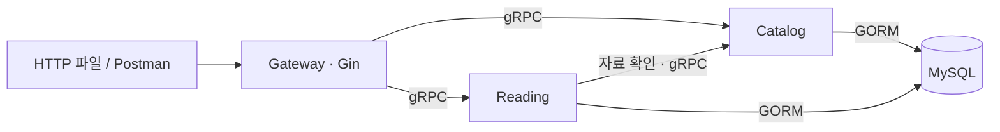

# 01. Spring의 역할로 Go 파일 찾기

목표는 **요청 하나가 어느 파일을 거치는지 설명하는 것**입니다. [README](../README.md)에서 서버를 실행하고 HTTP 파일의 요청을 순서대로 보내 보세요.

## 1. Gateway, Catalog, Reading은 애플리케이션 이름입니다

| 앱 | 역할 | 저장 |
| --- | --- | --- |
| Gateway :8080 | Gin으로 HTTP 요청 수신, RPC 호출, JSON 응답 | DB 직접 사용 안 함 |
| Catalog :9001 | 자료 등록·수정·조회 | catalog_resources 테이블 |
| Reading :9002 | 읽기 목록 생성·조회·읽음 상태 변경 | reading_lists, reading_items 테이블 |

세 앱 모두 별도 프로세스입니다. Controller/Service/Repository 같은 계층의 이름이 아닙니다. 통신과 장애를 실습하려고 나눴으며, 작은 서비스를 만들 때 항상 세 서버가 필요한 것은 아닙니다.



로컬 편의상 DB 하나를 공유하지만, Catalog와 Reading은 각자 소유한 테이블만 접근합니다. Reading은 Catalog 테이블을 직접 JOIN하지 않습니다.

## 2. 익숙한 역할에 대응시키세요

| Spring | Go 파일 | 하는 일 |
| --- | --- | --- |
| @PostMapping | [controller/http/router.go](../internal/controller/http/router.go) | URL과 메서드 연결 |
| @RequestBody DTO | [controller/http/dto.go](../internal/controller/http/dto.go) | JSON 필드·입력 형식 정의 |
| @RestController | [controller/http/reading.go](../internal/controller/http/reading.go) | HTTP DTO → RPC 요청, 응답 → JSON |
| RPC Controller | [controller/grpc/reading.go](../internal/controller/grpc/reading.go) | RPC DTO → 업무 입력, 업무 오류 → gRPC 상태 |
| @Service | [reading/usecase.go](../internal/reading/usecase.go) | 검증 → 자료 조회 → 저장 순서 결정 |
| Repository 인터페이스 | [reading/model.go](../internal/reading/model.go) | 필요한 저장 동작 정의 |
| Repository 구현체 | [repository/mysql/reading_repository.go](../internal/repository/mysql/reading_repository.go) | GORM 쿼리·트랜잭션 |
| @Entity | [repository/mysql/model.go](../internal/repository/mysql/model.go) | DB 컬럼·관계 매핑 |
| @Configuration / @Bean | [app/app.go](../internal/app/app.go) | 생성자와 구현체 연결 |

UseCase는 '목록을 생성한다' 같은 업무 흐름을 뜻합니다. 이 프로젝트에서는 Spring Service 역할입니다. 폴더를 service로 이름 붙여야만 Service가 되는 것은 아닙니다.

## 3. model.go와 school.proto는 같은 것이 아닙니다

Go에서 model.go는 특별한 기능을 가진 파일명이 아닙니다. 파일 안의 타입과 import를 보세요.

| 타입 | 용도 | 바뀌는 이유 |
| --- | --- | --- |
| HTTP DTO: createListRequest | 외부 JSON 입력 | HTTP API 필드 변경 |
| RPC DTO: pb.CreateListRequest | 서버 간 전송 | RPC 계약 변경 |
| 업무 모델: reading.List | 업무 규칙에 맞춘 데이터 | 목록 업무 변경 |
| DB Entity: mysql.ListEntity | 테이블 매핑 | DB 컬럼·인덱스 변경 |

`.proto`는 RPC DTO와 메서드의 **원본 계약**입니다. `make generate`가 [gen/school/v1](../gen/school/v1)에 Go 타입과 클라이언트·서버 인터페이스를 만듭니다. DB 테이블을 만드는 파일은 [migrations](../migrations)입니다.

서로 닮은 필드가 있어도 역할이 다르므로 Controller와 Repository에서 변환합니다. 예를 들어 DB 컬럼 이름을 바꿨다고 HTTP JSON 필드까지 같이 바꿀 필요가 없습니다.

## 4. pb는 패키지 별칭입니다

[RPC Controller](../internal/controller/grpc/catalog.go)의 import를 보세요.

```go
import pb "github.com/LeeJejune/go-school/go-practice/gen/school/v1"
```

`pb`는 개발자가 붙인 짧은 이름입니다. Go 예약어가 아닙니다. 이 파일에서 `pb.Resource`는 '위 경로에서 import한 패키지의 Resource 타입'입니다. 관례적으로 protobuf를 줄여 pb라고 쓰지만 다른 이름도 가능합니다.

`catalog.Catalog`도 같은 방식입니다. catalog 패키지에 있는 Catalog 타입입니다. 점 앞이 패키지 이름인지 변수인지 import와 선언을 함께 보세요.

## 5. &와 *는 위치를 나눠 읽으세요

| 표현 | 읽는 방법 |
| --- | --- |
| `value := T{}` | T 타입의 구조체 값 생성 |
| `p := &value` | value의 주소를 얻음. p의 타입은 *T |
| `var p *T` | T를 가리키는 포인터 변수 선언. 초기값은 nil |
| `copied := *p` | p가 가리키는 값을 읽어서 복사 |
| `&pb.ListResourcesResponse{}` | 응답 구조체 값을 만들고 그 주소를 얻음 |
| `*catalog.Catalog` | catalog.Catalog를 가리키는 포인터 **타입** |

`*`는 **타입 자리에서는 포인터 타입**, `*p`처럼 **값을 사용하는 자리에서는 역참조**입니다. `*catalog.Catalog`라는 타입을 적는 것만으로 객체가 생기지는 않습니다.

```go
func NewCatalog(catalog *catalog.Catalog, logger *slog.Logger) *Catalog
```

위는 실제 생성자의 선언 부분입니다. 인자의 `catalog`는 변수명, `*catalog.Catalog`는 인자 타입, 마지막 `*Catalog`는 반환 타입입니다. 생성자는 인자로 받은 업무 객체의 포인터를 Controller에 보관합니다.

Java 참조처럼 같은 대상에 접근할 수 있지만 Go는 값과 포인터를 구분합니다. 포인터도 인자로 전달할 때 그 포인터 값이 복사됩니다. nil 포인터 역참조는 panic을 일으킵니다. 구조체에 slice·map·포인터 필드가 있으면 구조체 복사만으로 내부 데이터까지 독립 복사되지는 않습니다.

작게 실행해 보는 연습은 [go-basic 포인터 설명](../../go-basic/docs/03-struct-methods.md)에 있습니다.

## 6. 첫 코드는 이 순서로 읽으세요

1. router.go에서 `POST /v1/lists`를 찾습니다.
2. HTTP CreateList에서 JSON 입력과 RPC 호출을 봅니다.
3. gRPC CreateList에서 업무 입력으로 바꾸는 부분을 봅니다.
4. UseCase.Create에서 입력 검증과 Catalog 조회를 봅니다.
5. Repository.Create에서 트랜잭션을 봅니다.

Controller가 ORM을 직접 호출하거나 업무 코드가 gin.Context를 요구하는지 확인해 보세요. 현재 업무 패키지는 Gin·gRPC·GORM을 import하지 않고 일반 Go 값과 context.Context를 받습니다.

[학습 순서](../README.md) · [다음: HTTP와 gRPC](02-grpc.md)
