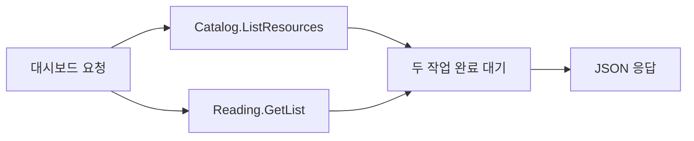

# 02. HTTP 요청이 gRPC를 거쳐 처리되는 과정

이 장의 목표는 **curl 요청 하나가 어느 서버의 어느 메서드로 가는지 설명하는 것**입니다. 모든 실행 명령은 go-practice 폴더에서 사용합니다. 먼저 [README](../README.md)에 따라 서버를 실행하세요.

## 1. Spring의 URL 매핑부터 연결해 봐요

Spring에서는 @PostMapping("/v1/lists")가 붙은 메서드를 찾았을 것입니다. 여기서는 [api/http.yaml](../api/http.yaml)에 연결 관계를 적습니다.

```yaml
- selector: school.v1.ReadingService.CreateList
  post: /v1/lists
  body: "*"
```

'POST /v1/lists의 JSON 본문을 받아 ReadingService의 CreateList RPC를 호출한다'고 읽습니다. 실제 파일에는 이 내용이 rules 아래에 있습니다.

| HTTP 요청 | 호출 대상 |
| --- | --- |
| GET /v1/resources | Catalog의 ListResources |
| POST /v1/lists | Reading의 CreateList |
| GET /v1/lists/{id} | Reading의 GetList |
| PATCH /v1/lists/{list_id}/items/{resource_id} | Reading의 SetRead |

매핑을 적는 것만으로 업무 코드가 구현되지는 않습니다. 생성된 연결 코드와 직접 작성한 요청 처리 메서드가 함께 동작합니다.

## 2. gRPC도 서버 간 요청·응답이에요

Spring에서 Feign이나 HTTP 클라이언트로 다른 서버를 호출하던 상황을 떠올리세요. 이 프로젝트에서는 gRPC 클라이언트를 사용합니다. 호출하는 코드는 메서드 호출처럼 보이지만 실제 네트워크 통신입니다.

따라서 상대 서버 중단, 시간 초과, 취소가 발생할 수 있습니다. 함수 호출 모양만 보고 같은 프로세스 안에서 항상 즉시 성공하는 호출로 생각하지 않으면 됩니다.

[school.proto](../api/proto/school/v1/school.proto)는 호출할 메서드와 주고받을 데이터를 정의합니다.

```protobuf
service ReadingService {
  rpc CreateList(CreateListRequest) returns (CreateListResponse);
}
```

여기의 service는 '공개 RPC 메서드 묶음'입니다. Spring의 업무 @Service annotation이나 reading.UseCase를 뜻하는 것은 아닙니다.

## 3. Protobuf message는 요청·응답 DTO의 설계도예요

```protobuf
message CreateListRequest {
  string request_key = 1;
  string title = 2;
  repeated string resource_ids = 3;
}
```

repeated string은 문자열을 여러 개 담는 필드입니다. 생성된 Go 코드에서는 []string으로 보게 됩니다.

| 위치 | 같은 필드가 보이는 이름 |
| --- | --- |
| .proto | request_key |
| 생성된 Go DTO | RequestKey |
| HTTP JSON | requestKey |

= 1 같은 숫자는 데이터 전송에서 필드를 구분하는 번호입니다. Java 변수에 값을 대입하는 문법으로 읽지 마세요. 이미 사용한 필드 번호를 다른 의미로 재사용하지 않습니다.

계약을 바꿀 때는 make tools로 도구를 준비하고 make generate를 실행합니다. 지금 실행만 하는 데는 필요 없습니다. [gen](../gen)은 생성 결과이므로 직접 수정하지 않습니다.

## 4. 목록 생성 요청을 끝까지 따라가요

README의 POST 요청을 실행하면 다음 순서로 진행됩니다.

1. Gateway가 HTTP JSON을 요청 DTO로 읽습니다.
2. Gateway가 생성된 gRPC 클라이언트로 Reading을 호출합니다.
3. [service.Reading.CreateList](../internal/service/reading.go)가 업무 입력 타입으로 바꿉니다.
4. [UseCase.Create](../internal/reading/usecase.go)가 제목과 자료 ID를 검사합니다.
5. [catalogclient.Client](../internal/catalogclient/client.go)가 Catalog에 자료 제목과 URL을 요청합니다.
6. Catalog 응답이 성공하면 Repository가 DB에 저장합니다.
7. 저장 결과가 응답 DTO를 거쳐 JSON으로 반환됩니다.

Gateway의 [server/http.go](../internal/server/http.go)에서는 RegisterReadingServiceHandlerClient에 실제 RPC 클라이언트를 전달합니다. HTTP 핸들러가 Reading의 업무 메서드를 같은 프로세스에서 직접 실행하는 구조는 아닙니다.

Catalog 조회는 자료별로 여러 번 호출하지 않고 BatchGetResources로 한 번에 요청합니다. 기존 목록의 조회와 읽음 상태 변경은 저장된 정보를 사용하므로 Catalog를 다시 조회하지 않습니다.

## 5. ctx는 요청의 취소와 제한 시간을 이어 줘요

서비스 메서드와 Repository에 있는 ctx context.Context는 '이번 작업이 취소됐는지, 언제까지 할 수 있는지'를 전달합니다. [기초 Context 예제](../../go-basic/docs/05-concurrency.md)에서 본 개념과 같습니다.

이 프로젝트의 기본 제한은 전체 요청 2초, Reading에서 하는 Catalog 조회 300ms입니다. 아래 호출에 Context를 넘겨 RPC와 DB 작업도 취소·제한 시간에 반응하게 합니다.

상위 요청에 시간이 적게 남았다면 하위 호출이 그보다 더 오래 쓸 수는 없습니다. 서버마다 같은 Go 객체가 공유되는 것이 아니라 RPC를 통해 취소와 마감시간 정보가 전달됩니다.

## 6. Go 오류가 HTTP 상태로 바뀌는 곳

Spring의 예외 처리기처럼 [service/reading.go의 rpcError](../internal/service/reading.go)가 업무 오류를 외부 응답으로 바꿉니다.

| 상황 | gRPC 코드 | HTTP 상태 |
| --- | --- | --- |
| 제목이 비었거나 자료가 잘못됨 | InvalidArgument | 400 |
| 목록이나 항목이 없음 | NotFound | 404 |
| 같은 요청 키에 다른 생성 내용 | AlreadyExists | 409 |
| Catalog에 접근할 수 없음 | Unavailable | 503 |
| 전체 요청 제한 시간 초과 | DeadlineExceeded | 504 |
| 예상하지 못한 저장 오류 | Internal | 500 |

내부 SQL 오류는 로그에 남기고 일반 오류로 응답합니다. Catalog의 짧은 조회 제한 초과는 의존성 조회 실패로 처리해 503이 될 수 있습니다. 모든 시간 초과가 무조건 504인 것은 아닙니다.

SetRead는 지정한 bool 값으로 상태를 맞추는 명령입니다. isRead를 생략하면 이 계약에서는 false로 해석되므로 PATCH라는 이름만 보고 '생략한 필드는 유지된다'고 생각하지 마세요.

## 7. 직접 goroutine을 쓰는 서버 기능도 있어요

GET /v1/dashboard/{id}는 자료 카탈로그와 기존 목록을 함께 보여 주는 조합 API입니다. 이 HTTP 경로는 [dashboard.Register](../internal/gateway/dashboard.go)에서 별도로 등록합니다.



두 조회는 서로의 결과가 필요 없어 [Dashboard.Get](../internal/gateway/dashboard.go)의 g.Go 두 개로 동시에 시작합니다. Java의 CompletableFuture로 독립 호출을 조합하던 목적과 비슷합니다. g.Wait는 두 작업이 끝나기를 기다리고, WithContext는 한쪽이 실패하면 다른 쪽에도 취소 신호를 전달합니다.

반면 목록 생성은 Catalog 응답으로 저장할 데이터를 만들어야 합니다. 이 경로는 순서대로 실행하는 것이 맞습니다.

HTTP/gRPC 서버 라이브러리는 여러 요청을 이미 동시에 처리합니다. Controller 역할의 메서드에 매번 go를 붙일 필요는 없습니다. 개발자가 직접 나누는 경우는 이 대시보드처럼 한 요청 안의 독립 작업을 함께 진행할 때입니다.

## 확인 문제

1. POST /v1/lists가 어떤 RPC를 호출하는지 어디서 찾나요?
2. Gateway에서 DB INSERT가 보이지 않는 이유는 무엇인가요?
3. 목록 생성과 대시보드는 어떤 이유로 처리 순서가 다른가요?

답: api/http.yaml에서 매핑을 찾습니다. 저장 책임은 Reading에 있습니다. 생성은 앞 조회 결과가 필요하고, 대시보드의 두 조회는 독립적입니다.

[이전: Spring 역할 대응](01-spring-to-go.md) · [다음: GORM과 DB](03-database.md)

더 읽기: [gRPC 소개](https://grpc.io/docs/what-is-grpc/introduction/), [errgroup 문서](https://pkg.go.dev/golang.org/x/sync/errgroup).
